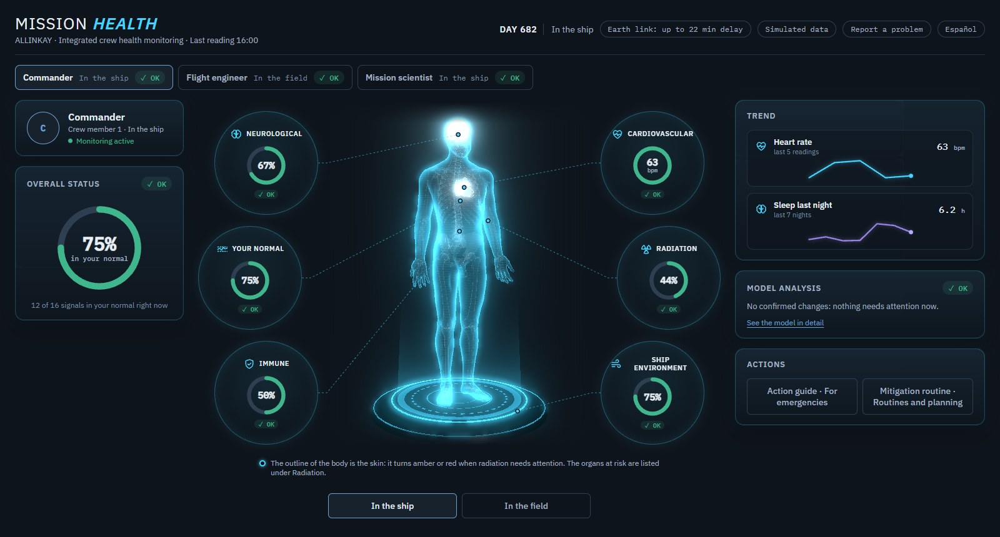

# ALLINKAY: onboard health monitoring for astronauts

ALLINKAY is a health monitor that a crew uses **on board**, without waiting for Earth. It shows each astronaut, in time, when their own body moves away from **their own normal**: in sleep, reaction time, mood, white blood cells, oxygen, the cabin air and the radiation they receive. It also says what to do about it. Changes that stay inside the general reference ranges are included.

Built for the NASA Space Apps Challenge 2026 challenge *Create Health Monitoring Software for Astronauts on Space Missions*.

**Live demo:** <https://allinkay.onrender.com>. It runs a simulated Mars mission where one second is one hour, so ten mission days pass in four minutes. The free hosting plan sleeps when idle, so the first load can take up to a minute.

**Project website:** <https://allinkay.onrender.com/site/>, with the 30-second mission story, the evidence and the roadmap.



## The problem

- **Help from Earth arrives late or not at all.** On a crewed Mars mission the one-way communication delay is 0 to 22 minutes, and blackouts can last from days to months ([McBrayer et al., 2022](https://ntrs.nasa.gov/citations/20220013418)). Today, health data from instruments such as the CSA Bio-Monitor and Bio-Analyzer is interpreted by teams on Earth.
- **General ranges hide personal changes.** In NASA's open Inspiration4 data, one day after landing three of the four crew members had 14% to 27% fewer white blood cells than their own pre-flight average, and none of them left the general range of 3.8 to 10.8 thousand per microlitre ([NASA OSDR, OSD-569](https://osdr.nasa.gov/bio/repo/data/studies/OSD-569)). Compared only with the general range, that change goes unnoticed.
- **Radiation adds up outside Earth's magnetosphere.** In transit to Mars, Curiosity measured about 1.8 mSv per day, so the round trip alone adds about 660 mSv ([Zeitlin et al., 2013](https://doi.org/10.1126/science.1235989)). NASA's career limit is 600 mSv ([NASA-STD-3001, OCHMO-TB-020](https://www.nasa.gov/sites/default/files/atoms/files/radiation_protection_technical_brief_ochmo.pdf)).
- **The risks act together.** NASA notes that poor sleep alters the immune system and lowers performance, so the signals matter together, not only one by one.

## What ALLINKAY does

- **One screen, around the body.** A 3D hologram of the astronaut (adapted from the BodyParts3D anatomy atlas) sits in the center, with a bubble for each system joined to the part of the body it watches. Only what needs attention turns amber or red, and selecting a bubble shows that system's readings in place. In the field, the hologram wears NASA's Z2 spacesuit, its prototype for planetary surfaces (NASA 3D Resources).
- **Your normal, not a general range.** Every signal is compared with that person's own baseline, built before flight.
- **Confirmed alerts, explained.** An alert names the signal, how far it moved, why it matters (with the NASA source) and what routine to follow. It never fires on a single noisy reading: live signals need 10 readings in a row; daily ones need 3 of the last 4 days; and an unusual lab exam is **repeated the next day** and only alerts if the repeat agrees.
- **Combined patterns.** When two or more systems move away at once, the alert says so.
- **Forecast.** It projects the next three nights of sleep with a margin, and the days left before the radiation career limit.
- **Radiation.** It shows the dose rate, the accumulated dose, the organs at risk and a solar storm emergency with a step-by-step action guide. Reaching the 600 mSv career limit raises an emergency (NASA-STD-3001 [V1 4030]).
- **In the ship or in the field.** In the field (spacewalk or surface) a lighter model watches only the portable sensors: heart rate, oxygen, body temperature and dose.
- **A whole crew.** Each member has their own normal, alerts and place. The demo crew is a commander and a mission scientist in the ship and a flight engineer in the field.
- **Works without Earth.** Everything runs on board. The crew can also report a problem from inside the app.

## How we kept false alarms down without missing real changes

No monitor can have zero false alarms and zero missed changes with finite data: lowering one raises the other. So we measured both and set targets.

- **Lab exams:** the person's set point is the mean of their pre-flight draws. The spread is the published within-subject and analytical variation, taken from the [EFLM Biological Variation Database](https://biologicalvariation.eu/): leukocytes 11.1%, glucose 4.9%. A result beyond the 99.5% reference change value (Fraser, 2001) asks for a repeat.
- **Personal normals** are judged with a prediction interval (Student's t and 1 + 1/n), because they come from a limited reference period.
- **Mood** is a 1 to 5 scale, so it counts whole steps.

Measured with [`backend/validate_model.py`](backend/validate_model.py), which runs the same loop as the app on 200 synthetic people over 90 days, plus 200 people per crew script:

| | Result | Target |
|---|---|---|
| False alarms, ship | 5 in 60 astronaut-years (about 1 every 12 years) | at most 1 every 10 years |
| False alarms, field | 0 in 55 astronaut-years | at most 1 every 10 years |
| Scripted changes missed within 10 days | 5 of 1200 (0.42%) | at most 1% |

These numbers come from synthetic people with normal noise. Real data has outliers and trends that this test does not cover, so the model must be validated on real data before it is used with people. The reasoning behind each choice is in [docs/decisions.md](docs/decisions.md) (D-011).

## Data and sources

| Source | Used for |
|---|---|
| [NASA OSDR, OSD-569](https://osdr.nasa.gov/bio/repo/data/studies/OSD-569) (Inspiration4 complete blood count) | The commander's white blood cell set point: crew member C001, pre-flight draws L-92, L-44 and L-3. The file is in [`data/osdr`](data/osdr). |
| [NASA OSDR, OSD-575](https://osdr.nasa.gov/bio/repo/data/studies/OSD-575) (Inspiration4 comprehensive metabolic panel) | The commander's glucose set point: the same crew member and draws, 83, 80 and 69 mg/dL. The file is in [`data/osdr`](data/osdr). |
| [NASA DONKI](https://ccmc.gsfc.nasa.gov/tools/DONKI/) (space weather event catalogue, CCMC) | The real event the demo storm refers to, shown on screen: the X5.4 solar flare of 7 March 2012 (peak 00:24 UTC) and the protons above 100 MeV that GOES-13 detected 3.7 hours later (event `2012-03-07T04:05:00-SEP-001`). The files are in [`data/donki`](data/donki). |
| [NASA OSDR, Environmental Data App](https://visualization.osdr.nasa.gov/eda/) (ISS cabin telemetry) | The level and spread of the synthetic cabin: the median of the Rodent Research missions, 22.55 °C (14 missions, 2014 to 2024) and 2913 ppm of CO2, about 2.2 mmHg (10 missions, 2014 to 2021). The summary by mission is in [`data/eda`](data/eda). |
| [NASA PDS, MSL RAD](https://pds-ppi.igpp.ucla.edu/data/MSL-M-RAD-3-RDR-V1.0/DATA/CRUISE/) (Curiosity's Radiation Assessment Detector in cruise, `MSL-M-RAD-3-RDR-V1.0`) | The demo's dose. It replays what RAD measured inside the spacecraft on its way to Mars from 29 February to 10 March 2012, storm of 7 March included: about 1.7 mSv per day before the storm, and on 8 March a second wave that crosses ten times that level and raises the storm emergency. Dose equivalent uses RAD's cosmic-ray quality factor (3.82, Zeitlin et al., 2013) and, for the storm's protons, the factor that matches the published 19.5 mSv (Guo et al., 2015). The file is in [`data/rad`](data/rad) and `scripts/build_rad_dose.py` rebuilds it. |
| [Guo et al., 2015](https://arxiv.org/abs/1503.06631) | Curiosity's RAD, inside the spacecraft on its way to Mars, recorded 19.5 mSv over the same storm (7 to 15 March 2012) |
| [NASA-STD-3001, OCHMO-TB-020 Rev G](https://www.nasa.gov/sites/default/files/atoms/files/radiation_protection_technical_brief_ochmo.pdf) | 600 mSv career limit [V1 4030], 250 mSv per solar particle event, ALARA principle [V1 4029] |
| NASA Human Research Program risk pages | The evidence cited in each alert: sleep, behavioural health, cardiovascular, immune, hypoxia and radiation |
| [Zeitlin et al., 2013](https://doi.org/10.1126/science.1235989) | Cruise dose rate to Mars, 1.8 mSv per day |
| [McBrayer et al., 2022](https://ntrs.nasa.gov/citations/20220013418) | Communication delay with Mars, 0 to 22 minutes one way |
| CSA [Bio-Analyzer](https://www.asc-csa.gc.ca/eng/iss/bio-analyzer.asp) and [Bio-Monitor](https://www.asc-csa.gc.ca/eng/sciences/astroskin.asp) | What can already be measured on board today |
| [EFLM Biological Variation Database](https://biologicalvariation.eu/) | Within-subject variation of leukocytes and glucose |
| Fraser, C. G. (2001). *Biological Variation: From Principles to Practice*. AACC Press. | Reference change value and the analytical goal (CVA = CVI / 2) |

**Every other reading in the demo is synthetic.** The radiation dose is RAD's measurement, and the commander's white blood cell and glucose normals come from the open, anonymised OSD-569 and OSD-575 datasets; no real person's data is used apart from those. The cabin temperature and CO2 readings are synthetic, centred on the real ISS cabin.

## Architecture

A modular monolith with a hexagonal (ports and adapters) design. The domain is plain Python with no input or output, so the same model can run on any onboard computer.

```
simulator (real sensors next)
        │
        ▼
    ingestion ──> SQLite
        │
        ▼
     domain: your normal, confirmed alerts, combined patterns,
             sleep forecast, radiation ledger
        │
        ▼
     FastAPI: REST, plus one live WebSocket per crew member
        │
        ▼
     React panel, in English and Spanish
```

- **Backend:** Python 3.13, FastAPI, Pydantic, NumPy, SQLite, Uvicorn.
- **Frontend:** React 19, Vite, TypeScript and three.js (the 3D hologram).
- **Quality:**
  - Ruff, pytest (149 tests), ESLint and Vitest (44 tests), and gitleaks.
  - GitHub Actions runs everything on every pull request, with actions pinned by hash.
- **Deployment:** one Docker image on Render (the API also serves the built panel).

## Run it locally

You need Python 3.13 and Node 24.

```bash
cd backend && python -m venv .venv && .venv/bin/pip install -r requirements-dev.lock && cd ..
cd frontend && npm ci && cd ..
python scripts/demo.py
```

Open <http://localhost:8000>. Add `--speed 14400` to make a mission day pass in six seconds.

Other commands:

```bash
python scripts/verify.py
```

The full quality gate: lint, tests, build and secret scan.

```bash
cd backend && .venv/bin/python validate_model.py --people 200 --days 90
```

Measures false alarms and missed changes.

On Windows, use `.venv\Scripts\` instead of `.venv/bin/`.

## Limits

- ALLINKAY is decision support, not a diagnosis or a medical device.
- The demo uses synthetic readings. Real sensors (for example an AD8232 ECG module on an ESP32) are the next step: they would feed the same ingestion port. The planned parts and milestones are in the [hardware roadmap](docs/hardware-roadmap.md); only a first bench recording exists so far.
- Blood pressure and lab exams cannot yet be measured by low-cost portable modules, so in the field mode they are not watched.

## License

[Apache License 2.0](LICENSE). See [NOTICE](NOTICE) for credits and the NASA data citations.
